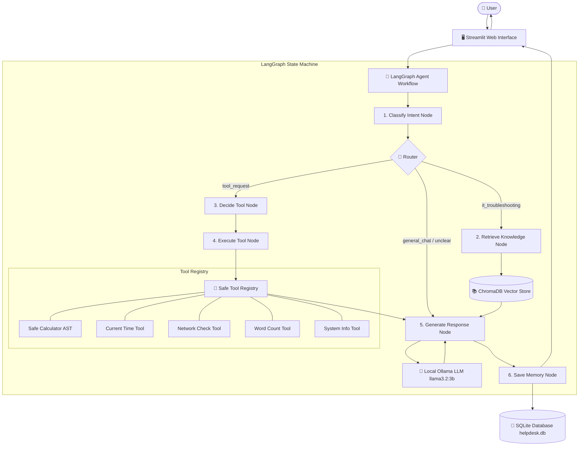

# AI IT Helpdesk Agent 🛠️
> **An Intelligent Agentic AI Technical Support System Powered by LangGraph, Local Ollama LLM, ChromaDB RAG, Safe Diagnostic Tools, and Persistent SQLite Memory.**

---

## 1. Project Overview
The **AI IT Helpdesk Agent** is an end-to-end autonomous technical support agent engineered as a capstone individual project following a 5-day IBM Agentic AI Internship. Rather than operating as a simple static chatbot, this system demonstrates true **Agentic AI architecture**: it autonomously determines user intent, conditionally branches between Retrieval-Augmented Generation (RAG) and specialized diagnostic tools, verifies execution outputs, maintains short-term conversational context as well as cross-session persistent SQLite memory, and delivers structured, safe, step-by-step remediation procedures.

All language model inference runs locally via **Ollama** (`llama3.2:3b`), ensuring zero API costs, high data privacy, and complete offline availability.

---

## 2. Problem Statement
Tier-1 IT Helpdesk personnel spend up to 70% of their time answering recurring, predictable support requests: Wi-Fi connection drops, frozen print spoolers, sluggish laptops, forgotten credentials, and peripheral connectivity errors. Traditional rule-based chatbots frequently fail because they cannot reason dynamically, lack structured troubleshooting workflows, cannot execute safe hardware/network diagnostic checks, and fail to retain context across support sessions. 

The **AI IT Helpdesk Agent** resolves this bottleneck by deploying an agentic state-machine workflow that routes problems intelligently to domain-specific knowledge or non-invasive system diagnostic tools.

---

## 3. Objectives
- **Agentic Intent Routing**: Classify requests dynamically using LangGraph conditional edges without brittle regex or hard-coded if-else trees.
- **Grounded Troubleshooting (RAG)**: Index 18 categorized IT troubleshooting runbooks into a local vector store (ChromaDB) to ground answers and eliminate hallucinations.
- **Safe Diagnostic Tools**: Provide LangChain tools for mathematical calculations (safe AST parsing without `eval()`), network reachability, system time, word analysis, and non-invasive system diagnostics.
- **Dual-Tier Memory**: Provide in-memory session history for fluid conversation and persistent SQLite storage across user sessions.
- **Human-Centric Streamlit UI**: Provide an intuitive web interface showing real-time agent status banners without leaking raw internal chain-of-thought traces.

---

## 4. Key Features
- **18 Curated IT Knowledge Base Documents**: Full runbooks for Wi-Fi, DNS/Internet, Slow Speeds, Bluetooth, Printers, Keyboards, Mice, Overheating, System Lag, Windows Updates, Software Installers, App Crashes, Account/MFA Lockouts, Outlook/Exchange, LAN/Ethernet, Antivirus/Security, Low Disk Space, and USB Device Detection.
- **Safe Math Engine**: Custom AST (Abstract Syntax Tree) arithmetic evaluator preventing remote code execution.
- **Non-Invasive Diagnostics**: Safe socket connection test (`8.8.8.8:53`) and platform system specs retrieval without administrative escalation.
- **Structured Remediation Format**: Consistent output format providing `Possible cause`, `Try these steps (numbered 1 to 5)`, and `If the problem remains` escalation warnings.
- **Complete Privacy**: Zero external cloud API calls required; LLM runs on-device via Ollama.

---

## 5. Agentic AI Architecture Diagram



---

## 6. Technologies Used

| Layer | Technology | Purpose |
|---|---|---|
| **Language** | Python 3.11+ | Core application runtime |
| **LLM Runtime** | Ollama (`llama3.2:3b`) | Local, privacy-preserving model inference |
| **Agent Framework** | LangGraph (`>=0.2.20`) | Cyclic state machine, node dispatch, conditional routing |
| **LLM Framework** | LangChain Core & Community (`>=0.3.0`) | Tool decorators, schemas, document handling |
| **Vector Store** | ChromaDB (`>=0.5.5`) | Local persistence vector database for RAG |
| **Embeddings** | HuggingFace (`all-MiniLM-L6-v2`) / Ollama | Fast, CPU-friendly document vectorization |
| **Relational Database** | SQLite 3 | Persistent storage of messages, sessions, and state |
| **Frontend** | Streamlit (`>=1.38.0`) | Interactive web chat interface with live status |
| **Data Validation** | Pydantic v2 | Strict argument schemas for tools and graph state |

---

## 7. Folder Structure

```text
ai-it-helpdesk-agent/
│
├── app.py                      # Streamlit interactive chat UI
├── requirements.txt            # Python dependencies (modern LangChain/LangGraph)
├── README.md                   # Comprehensive project documentation
├── .env.example                # Sample environment variables
├── .gitignore                  # Git ignore rules for virtualenv, DBs, and vectors
│
├── config/
│   └── config.py               # Centralized configuration & environment loader
│
├── agent/
│   ├── __init__.py             # Agent module initialization
│   ├── state.py                # TypedDict LangGraph state schema
│   ├── prompts.py              # Structured system, classification & RAG prompts
│   ├── nodes.py                # Graph nodes (classify, retrieve, execute, generate, save)
│   └── graph.py                # StateGraph assembly, conditional edges, and runner
│
├── tools/
│   ├── __init__.py             # Tool registry and export dictionary
│   ├── calculator.py           # Safe AST-based arithmetic evaluator (No eval)
│   ├── time_tool.py            # Local date and time diagnostic tool
│   ├── network_tool.py         # Non-invasive socket ping & DNS resolver tool
│   ├── word_count.py           # Word, character, and sentence metric tool
│   └── system_info.py          # Platform, OS, CPU & memory spec diagnostic tool
│
├── rag/
│   ├── __init__.py             # RAG module exports
│   ├── document_loader.py      # Markdown reader and recursive text splitter
│   ├── embeddings.py           # Embedding provider (HuggingFace/Ollama)
│   ├── vector_store.py         # ChromaDB creation, persistence, and loading
│   └── retriever.py            # Semantic similarity query and source extraction
│
├── memory/
│   ├── __init__.py             # Memory module exports
│   └── database.py             # SQLite manager (sessions, messages, state)
│
├── knowledge_base/             # 18 Standard IT Troubleshooting Runbooks
│   ├── wifi.md                 # Wi-Fi not connecting
│   ├── internet.md             # No internet connection (APIPA/Gateway)
│   ├── slow_internet.md        # High latency / bandwidth bottlenecks
│   ├── bluetooth.md            # Bluetooth pairing / driver problems
│   ├── printer.md              # Spooler freezes / offline printer
│   ├── keyboard.md             # Repeating / unresponsive keys & filter keys
│   ├── mouse.md                # Pointer freezing & driver problems
│   ├── overheating.md          # Laptop thermal shutdown & fan noise
│   ├── slow_computer.md        # High CPU/RAM & startup bloat
│   ├── windows_update.md       # Windows update error codes & cache purge
│   ├── software_installation.md# MSI installer errors & permission fixes
│   ├── application_problems.md # App crashes & AppData corruption
│   ├── login_problems.md       # Locked accounts & MFA desynchronization
│   ├── email.md                # Outlook offline / OST file rebuild
│   ├── network.md              # Ethernet links & IP conflict resolution
│   ├── security.md             # Malware quarantine & browser notification hijacking
│   ├── storage.md              # Low C: drive capacity & temporary file purges
│   └── usb.md                  # USB device descriptor failure / code 43
│
├── scripts/
│   └── build_vector_db.py      # Standalone CLI vector database indexer
│
├── data/
│   └── helpdesk.db             # Generated SQLite database (created on first run)
│
└── vectorstore/
    └── chroma/                 # Generated ChromaDB vectors (created by build script)
```

---

## 8. Installation & Setup Guide

Follow these steps sequentially to set up and run the application locally on Windows, macOS, or Linux.

### Step 1: Install Ollama & Pull the Model
1. Download Ollama from [https://ollama.com/download](https://ollama.com/download) and install it.
2. Open a terminal or Command Prompt and verify Ollama is running:
   ```bash
   ollama --version
   ```
3. Pull the lightweight `llama3.2:3b` model:
   ```bash
   ollama pull llama3.2:3b
   ```
4. Verify the model is ready:
   ```bash
   ollama list
   ```

### Step 2: Create Python Virtual Environment
Open a terminal in the project directory:

```bash
# Clone or navigate to the project directory
cd ai-it-helpdesk-agent

# Create a clean Python virtual environment
python3 -m venv .venv

# Activate the virtual environment
# On macOS / Linux:
source .venv/bin/activate

# On Windows (Command Prompt):
.venv\Scripts\activate.bat

# On Windows (PowerShell):
.venv\Scripts\Activate.ps1
```

### Step 3: Install Required Python Packages
```bash
pip install --upgrade pip
pip install -r requirements.txt
```

### Step 4: Configure Environment Variables
Copy the example environment configuration file:
```bash
cp .env.example .env
```
*(Default settings in `.env.example` point to `http://localhost:11434` with model `llama3.2:3b` and work out of the box).*

### Step 5: Build the Vector Database
Populate the ChromaDB vector database from the 18 markdown documents in `knowledge_base/`:
```bash
python scripts/build_vector_db.py
```
**Expected Output:**
```text
=================================================================
  AI IT Helpdesk Agent - Vector Database Build Script
=================================================================
Knowledge Base Source Directory: knowledge_base
Vector Database Target Path:     vectorstore/chroma
-----------------------------------------------------------------
-> Loading knowledge documents from: knowledge_base
-> Loaded 18 documents. Splitting into semantic chunks...
-> Created 38 chunks.
-> Initializing embeddings and generating vectors...
-> Successfully indexed 38 chunks into ChromaDB at: vectorstore/chroma
-----------------------------------------------------------------
SUCCESS: ChromaDB vector store built successfully!
Total chunks indexed: 38
You can now run the Streamlit application: streamlit run app.py
=================================================================
```

### Step 6: Launch the Streamlit Web Application
```bash
streamlit run app.py
```
Open your browser at `http://localhost:8501`.

---

## 9. How the Agent Works (LangGraph Workflow)

When the user submits a message, the following lifecycle executes within the compiled LangGraph state machine:

1. **`classify_intent` Node**:
   - The user's query is analyzed.
   - Categorized into one of four states:
     - `it_troubleshooting` (Hardware, software, network, login problems)
     - `tool_request` (Math, time, network connectivity, system specs, word count)
     - `general_chat` (Greetings, agent capabilities, casual feedback)
     - `unclear` (Vague or incomplete input)
2. **Conditional Router**:
   - Evaluates state and branches execution dynamically:
     - If `it_troubleshooting` ➔ Routes to `retrieve_knowledge`.
     - If `tool_request` ➔ Routes to `decide_tool`.
     - If `general_chat` or `unclear` ➔ Routes directly to `generate_response`.
3. **`retrieve_knowledge` Node**:
   - Performs a semantic vector similarity search against local ChromaDB using embedding vectors.
   - Extracts the top 4 chunks with document titles, categories, and file sources.
4. **`decide_tool` and `execute_tool` Nodes**:
   - Matches the intended tool and dispatches parameters to the LangChain `@tool` function.
   - The tool executes deterministically and records the output in the state.
5. **`generate_response` Node**:
   - Prompts Ollama with the system prompt, retrieved knowledge chunks, and short-term chat history.
   - Enforces the 3-part structured troubleshooting format.
   - Explicitly cites that the guidance is grounded in the IT Knowledge Base.
6. **`save_memory` Node**:
   - Commits both the user query and the agent response (along with intent, citations, tool outputs, and timestamps) to the persistent SQLite database (`data/helpdesk.db`).

---

## 10. Tools Implementation & Safety Details

| Tool Name | Implementation | Safety Mechanism |
|---|---|---|
| **Calculator** | `tools/calculator.py` | Parses syntax into an `ast.AST` tree and computes via Python's `operator` module. **NEVER uses `eval()`**, preventing arbitrary code injection. |
| **Current Time** | `tools/time_tool.py` | Uses Python's `datetime.now()` to return clean, localized time strings. |
| **Network Check** | `tools/network_tool.py` | Performs a non-invasive TCP socket handshake (`socket.connect_ex`) to Google Public DNS (`8.8.8.8:53`) and tests domain name resolution. Does not execute root `ping` commands. |
| **Word Count** | `tools/word_count.py` | Analyzes text length, character counts (with and without whitespace), and sentence counts. |
| **System Info** | `tools/system_info.py` | Inspects safe platform modules (`platform.system()`, Python version, core counts, RAM availability). Does not access user files or credentials. |

---

## 11. Persistent Memory & SQLite Schema

Conversation records are saved in `data/helpdesk.db` across two relational tables:

```sql
-- Messages and Agent State History
CREATE TABLE conversation_history (
    id INTEGER PRIMARY KEY AUTOINCREMENT,
    user_id TEXT NOT NULL,
    session_id TEXT NOT NULL,
    role TEXT NOT NULL,
    message TEXT NOT NULL,
    intent TEXT,
    tool_used TEXT,
    metadata TEXT,
    timestamp TEXT NOT NULL
);

-- Session Metadata
CREATE TABLE user_sessions (
    session_id TEXT PRIMARY KEY,
    user_id TEXT NOT NULL,
    title TEXT,
    created_at TEXT NOT NULL,
    updated_at TEXT NOT NULL
);
```

When a returning user inputs their `User ID` (e.g., `student001`), the sidebar automatically lists all previous conversation sessions, allowing users to resume prior troubleshooting threads.

---

## 12. Example Questions to Test the Agent

### A. IT Troubleshooting Queries (RAG Pipeline)
1. **Wi-Fi Problem**:
   - *Query*: `"My Wi-Fi is not connecting on my laptop."*
   - *Expected Flow*: Classify ➔ `it_troubleshooting` ➔ RAG retrieval from `wifi.md` ➔ Formatted response with numbered steps (verify toggle, reset adapter, forget network, flush DNS).
2. **Printer Problem**:
   - *Query*: `"My printer is showing offline and nothing is printing."*
   - *Expected Flow*: Classify ➔ `it_troubleshooting` ➔ RAG retrieval from `printer.md` ➔ Print spooler restart instructions and offline toggle checks.
3. **Laptop Overheating**:
   - *Query*: `"My laptop fan is running loud and the bottom is very hot."*
   - *Expected Flow*: Classify ➔ `it_troubleshooting` ➔ RAG retrieval from `overheating.md` ➔ Elevating laptop, clearing dust with compressed air, and checking Task Manager.
4. **Login / Password**:
   - *Query*: `"My account is locked out and MFA is not sending a code."*
   - *Expected Flow*: Classify ➔ `it_troubleshooting` ➔ RAG retrieval from `login_problems.md` ➔ Time-drift synchronization advice and SSPR reset guidance.

### B. Tool Execution Queries
1. **Safe Calculator**:
   - *Query*: `"What is 25 multiplied by 4?"* or `"Calculate (1200 / 4) + 50"*
   - *Expected Flow*: Classify ➔ `tool_request` ➔ Tool: `calculator` ➔ AST evaluation ➔ `Result: 100` / `Result: 350.0`.
2. **Current Time**:
   - *Query*: `"What time is it right now?"*
   - *Expected Flow*: Classify ➔ `tool_request` ➔ Tool: `current_time` ➔ Formatted system time string.
3. **Network Connectivity Check**:
   - *Query*: `"Check if the system has internet connection"*
   - *Expected Flow*: Classify ➔ `tool_request` ➔ Tool: `network_check` ➔ TCP reachability test to 8.8.8.8 and DNS status.
4. **System Information**:
   - *Query*: `"Show me my computer system specs and OS version"*
   - *Expected Flow*: Classify ➔ `tool_request` ➔ Tool: `system_info` ➔ Safe OS, CPU, RAM and Python metrics.
5. **Word Count**:
   - *Query*: `"Count the words in: The quick brown fox jumps over the lazy dog"*
   - *Expected Flow*: Classify ➔ `tool_request` ➔ Tool: `word_count` ➔ Word: 9, Characters: 43.

---

## 13. Troubleshooting Common Errors

### 1. `Ollama Service Unavailable / Connection Refused`
- **Cause**: Ollama background service is not running.
- **Fix**: Open a separate terminal and run `ollama serve`. Keep the terminal open.

### 2. `model 'llama3.2:3b' not found`
- **Cause**: The model was not downloaded to your local Ollama storage.
- **Fix**: Run `ollama pull llama3.2:3b`.

### 3. `Vector Database Not Initialized`
- **Cause**: The Streamlit app was started before indexing the knowledge base.
- **Fix**: Run `python scripts/build_vector_db.py`.

### 4. `ModuleNotFoundError: No module named 'langchain_ollama'`
- **Cause**: Active Python environment is missing dependencies.
- **Fix**: Ensure your virtual environment is active (`source .venv/bin/activate` or `.venv\Scripts\activate`) and run `pip install -r requirements.txt`.

---

## 14. GitHub Upload Instructions

To submit or showcase your project on GitHub:

```bash
# 1. Initialize git repository
git init

# 2. Stage all project files (sensitive .db and cache files are ignored via .gitignore)
git add .

# 3. Commit your files
git commit -m "feat: complete AI IT Helpdesk Agent with LangGraph, RAG, and Streamlit"

# 4. Create a new repository on GitHub (e.g. ai-it-helpdesk-agent)
# 5. Link local repository to remote origin
git branch -M main
git remote add origin https://github.com/<your-username>/ai-it-helpdesk-agent.git

# 6. Push to GitHub
git push -u origin main
```

---

## 15. Future Improvements
- **Multi-Modal Diagnostics**: Allow users to drag-and-drop screenshots of Blue Screen of Death (BSOD) or hardware error dialogues for OCR/Vision analysis.
- **Ticketing Integration**: Automatically generate ServiceNow or Jira Service Management API tickets when problems require Level 2 human technician escalation.
- **Automated PowerShell Script Generator**: Generate verified, copy-pasteable PowerShell repair scripts for administrative users.

link : https://ais-pre-bw7zdwmruyp56dl2bpbvxg-71712320395.asia-southeast1.run.app/
